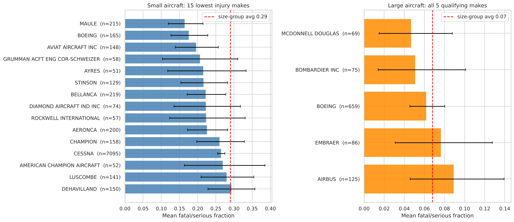
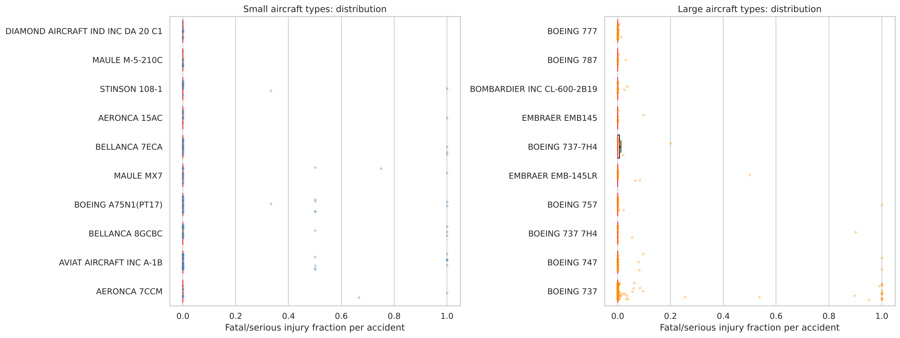
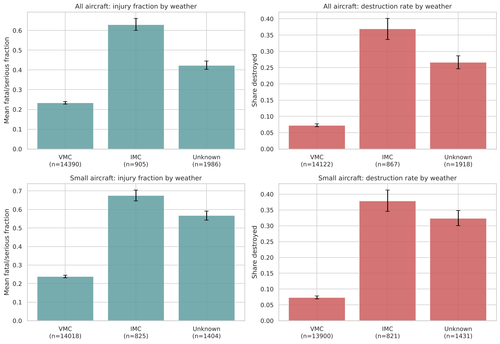
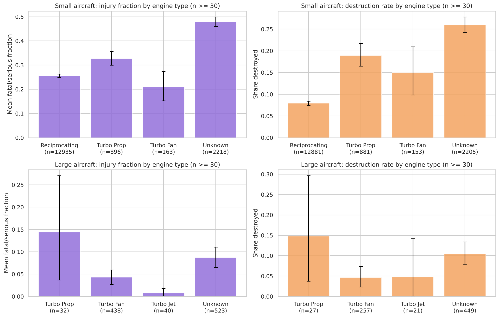

# Aviation Accident Safety Analysis (1983–2022)

**Client:** an airline / airplane insurer  
**Question:** Which aircraft makes and models have a low rate of total destruction and a low likelihood of fatal or serious passenger injury *when an accident happens*, and which general conditions drive the severity of an accident?

The analysis uses the aviation accident data set (1948–2023) from [Kaggle](https://www.kaggle.com/datasets/mos3santos/acidentes-de-aviao-at-2023). The cleaned analysis set covers **18,072 accidents between March 1983 and December 2022**.

## Scope of the analysis

- Airplanes only (no helicopters, gliders, balloons, etc.)
- Professional builds only (amateur-built aircraft removed)
- Events from 1983 onward, assuming a maximum 40-year service life for a make/model
- Small and large aircraft are analysed separately, using a passenger threshold of 20

## Measures

| Measure | Definition | Lower is… |
|---|---|---|
| `fatal_serious_fraction` | (fatal + serious injuries) ÷ estimated people on board | safer |
| `destroyed` | 1 if the aircraft was destroyed, 0 if it had substantial or minor damage | safer |

## Method highlights

- **Size classification is done per aircraft type, not per accident.** A Boeing 737 accident that involved only crew would otherwise be labelled "small". Each `make_model` is classified once (large if the 90th percentile of recorded occupancy is above 20, or at least two accidents had more than 100 people on board) and every accident inherits that class. One documented manual override: McDonnell Douglas MD-11.
- **Minimum sample sizes:** a make needs at least 30 accidents with a known outcome inside its size group; a model needs at least 10.
- **Every mean is shown with a 95% bootstrap confidence interval.** A difference is only called real when the intervals or a statistical test support it (Mann-Whitney, chi-square, Kruskal-Wallis).
- **Everything is conditional on an accident having occurred.** The data has no flight counts, so none of these numbers is a per-flight risk.

## Recommendations

### Small aircraft (moderate confidence)
Makes that are low on both measures and have a solid number of accidents behind them:

| Make | Fatal/serious fraction | Destruction rate | Accidents |
|---|---|---|---|
| Maule | 0.165 | 0.042 | 215 |
| Aviat | 0.196 | 0.068 | 148 |
| Stinson | 0.216 | 0.023 | 129 |
| Aeronca | 0.226 | 0.035 | 200 |
| Bellanca | 0.223 | 0.050 | 219 |

- Size-group averages: 0.289 (injury) and 0.111 (destruction).
- Grumman/Schweizer has the best combined rank (destruction 0.017) but only 58 accidents and a wide injury interval (0.103–0.310).
- **Cessna** (0.265 / 0.097, n ≈ 7,000) is a well-measured, modestly better-than-average default. **Piper** (0.295) is slightly worse than average.
- "Boeing" in the small group is the vintage Stearman biplane (A75N1/PT-17), not a jet.
- Several low-risk makes (Stinson, Aeronca, Luscombe, Taylorcraft) are legacy types; check how many are still in service and insurable.
- Best-supported **models** (n ≥ 10): Aviat A-1B (0.159, n=44), Boeing Stearman A75N1/PT-17 (0.140, n=31), Bellanca 7ECA (0.120, n=25), Bellanca 8GCBC (0.152, n=23). Diamond DA-20 C1 and Maule M-5-210C show 0.000 but rest on only 11 accidents each.

### Large aircraft (lower confidence)
Only five makes clear the sample-size rule, and their confidence intervals overlap, so the data **cannot statistically rank them**.

| Make | Fatal/serious fraction | Destruction rate | Accidents (injury / destruction) |
|---|---|---|---|
| Boeing | 0.062 | 0.072 | 659 / 498 |
| Bombardier | 0.051 | 0.053 | 75 / 57 |
| Embraer | 0.077 | 0.077 | 86 / 52 |
| McDonnell Douglas | 0.047 | 0.138 | 69 / 58 |
| Airbus | 0.089 | 0.137 | 125 / 73 |

- **Boeing** is the best-supported choice: low on both measures with by far the tightest intervals.
- Bombardier is slightly lower than Boeing on both measures, but on far fewer accidents.
- McDonnell Douglas has the lowest injury fraction but a high destruction rate. Airbus has the highest injury fraction of the five.
- Best-evidenced **models:** Boeing 777 (0.001, n=41), 787 (0.003, n=12), Bombardier CL-600-2B19 (0.003, n=18) and Boeing 737 (0.082, n=199, the most precisely measured).
- Caution: the fraction divides by everyone on board, so one serious injury on a 300-seat aircraft scores far lower than the same injury on a 4-seat aircraft. This favours large aircraft mechanically.





## Factors that affect accident severity

### 1. Weather condition: instrument conditions (IMC) are far deadlier than visual conditions (VMC)

| Group | Fatal/serious fraction VMC → IMC | Destruction rate VMC → IMC |
|---|---|---|
| Small aircraft | 0.239 → 0.676 (n=14,018 / 825) | 0.073 → 0.379 |
| Large aircraft | 0.037 → 0.145 (n=372 / 80) | 0.036 → 0.196 |

In small aircraft an IMC accident has roughly 2.8× the injury fraction and 5× the destruction rate (Mann-Whitney p ≈ 2e-174, chi-square p ≈ 1e-192). The effect holds for large aircraft too (p = 1.8e-5 and 2.1e-4), with less precision because only 80 large-aircraft IMC accidents exist. IMC accidents are only about 5–6% of small-aircraft accidents with known weather, but far more severe once they happen.



### 2. Engine type: only meaningful within a size class

Pooled across all aircraft, turbofans look far safer (0.088) than piston engines (0.255), but this mostly reflects aircraft size, since turbofans power the large jets. Within **small aircraft**:

| Engine | Fatal/serious fraction | Destruction rate |
|---|---|---|
| Reciprocating | 0.255 (n=12,935) | 0.079 |
| Turbo Prop | 0.327 (n=896) | 0.190 |
| Turbo Fan | 0.210 (n=163) | 0.150 |

- Turbo props have a significantly higher injury fraction than piston aircraft (Bonferroni-adjusted p = 4.5e-7); turbofans do not differ significantly (p = 0.29).
- Destruction rates differ strongly across engine types (chi-square p ≈ 8e-30), and piston aircraft are destroyed least often.
- Large-aircraft turboprop and turbojet groups are too small for firm conclusions.



## Limitations

- No flight-hour or departure counts, so these are severity-given-accident figures, not per-flight risk.
- Occupancy is the number of people recorded in the accident, not seat capacity, so the small/large split is a proxy.
- About 5% of injury outcomes and 6% of damage outcomes are unknown and were excluded from the statistics that use them.
- About 3,400 accidents have an unknown engine type and a high injury fraction (0.40), so engine findings describe the known-engine subset only.
- Weather and engine comparisons are observational; they do not isolate cause (for example, IMC accidents also differ in phase of flight and pilot experience).

## Repository structure

```
Data-Analysis-Jet-Airline-Safety/
├── README.md
├── requirements.txt
├── 01_Aviation_Accidents_Cleaning.ipynb      # Part 1: load, inspect, clean, build measures
├── 02_Aviation_Accidents_Data_Analysis.ipynb # Part 2: EDA, recommendations, two factors
├── data/
│   ├── AviationData.csv                      # raw accident data (88,889 rows x 31 columns)
│   ├── USState_Codes.csv                     # state lookup supplied with the lab
│   └── aviation_cleaned.csv                  # output of Part 1 (18,072 rows x 37 columns)
└── images/                                   # figures saved by the analysis notebook
```

## How to run

1. Use the `learn-env` conda environment (needs pandas, numpy, matplotlib, seaborn >= 0.13, scipy; see `requirements.txt`).
2. Run `01_Aviation_Accidents_Cleaning.ipynb` top to bottom. It reads `data/AviationData.csv` and writes `data/aviation_cleaned.csv`.
3. Run `02_Aviation_Accidents_Data_Analysis.ipynb` top to bottom. It reads the cleaned file and writes every figure to `images/`.

Both notebooks are executed and saved with their outputs, so they can be read directly on GitHub without re-running.
